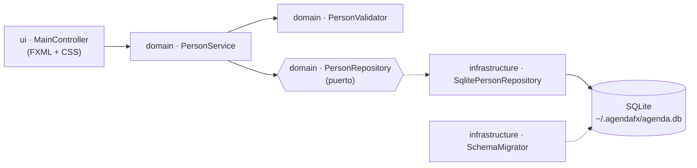

# AgendaFX

[](https://github.com/jairoben/jairo_tableview/actions/workflows/ci.yml)

Gestor de contactos de escritorio hecho con **JavaFX** y **SQLite**. La tabla se edita desde un
formulario lateral, la búsqueda filtra mientras escribes y los datos se guardan en un fichero
SQLite, así que siguen ahí al cerrar y volver a abrir la aplicación.


## Qué hace

- **CRUD completo**: alta de contactos, edición del seleccionado y borrado con confirmación.
- **Búsqueda en vivo** por nombre, apellidos o correo, sin recargar la tabla.
- **Persistencia real** en SQLite (un fichero, sin servidor ni instalación aparte).
- **Validación en el dominio**: campos obligatorios, formato de correo, longitudes y fechas futuras.
- **Correo único**: la base de datos tiene índice único y el servicio avisa antes de repetirlo.
- **Logs** con SLF4J + Logback y **22 tests** automáticos que cubren dominio e infraestructura.

## Requisitos

- JDK 21
- Maven 3.9 o superior

## Cómo ejecutarlo

```bash
mvn javafx:run
```

La base de datos se crea sola en `~/.agendafx/agenda.db`. Para usar otra ruta:

```bash
mvn javafx:run -Dagenda.db=./agenda.db
```

Compilar y pasar los tests:

```bash
mvn verify
```

## Arquitectura

Tres capas con dependencias hacia dentro: la interfaz y la base de datos dependen del dominio,
nunca al revés.



```
src/main/java/com/jairoben/agenda/
├── AgendaApp.java               # arranque: configuración, migración, servicio, escena
├── Launcher.java                # main sin extender Application (evita el error de módulos)
├── config/AppConfig.java        # application.properties + ruta de la base de datos
├── domain/
│   ├── Person.java              # record inmutable
│   ├── PersonValidator.java     # reglas de validación
│   ├── PersonService.java       # casos de uso
│   ├── PersonRepository.java    # puerto de persistencia
│   └── ValidationException.java
├── infrastructure/
│   ├── ConnectionFactory.java
│   ├── SchemaMigrator.java      # ejecuta resources/db/schema.sql
│   ├── SqlitePersonRepository.java
│   └── RepositoryException.java
└── ui/MainController.java       # tabla, formulario, búsqueda y mensajes
```

## Decisiones de diseño

- **`record` para el modelo**: un contacto es inmutable; modificar siempre crea una instancia nueva
  y así no hay estados a medias entre la tabla y la base de datos.
- **Puerto + adaptador**: `PersonService` solo conoce `PersonRepository`. Los tests del servicio
  corren con un repositorio en memoria y no tocan disco.
- **Validación fuera de la interfaz**: las mismas reglas las usan la UI y los tests, sin duplicar
  condiciones en el controlador.
- **Esquema idempotente**: `schema.sql` usa `CREATE ... IF NOT EXISTS`, así que se puede ejecutar en
  cada arranque sin miedo.
- **Una conexión por operación**: para una agenda personal es suficiente y evita fugas; si creciera,
  el siguiente paso natural sería un pool (HikariCP).
- **Errores separados**: `ValidationException` es un error de negocio con mensaje para el usuario;
  `RepositoryException` es un fallo técnico que se registra en el log.

## Tests

```bash
mvn verify
```

| Suite | Qué cubre |
| --- | --- |
| `PersonValidatorTest` (6) | Campos obligatorios, formato de correo, longitudes y fechas futuras |
| `PersonServiceTest` (8) | Alta, normalización del correo, duplicados, edición, borrado y búsqueda |
| `SqlitePersonRepositoryTest` (8) | CRUD real contra SQLite, orden, búsqueda y persistencia tras reiniciar |

El workflow [`ci.yml`](.github/workflows/ci.yml) los ejecuta en GitHub Actions con JDK 21 en cada
push y en cada pull request.

## Sobre el nombre del repositorio

El repositorio nació como un ejercicio de clase de `TableView` con una lista en memoria. Se ha
reescrito por completo como aplicación con persistencia y arquitectura por capas; el nombre se
mantiene por historial.

## Licencia

[MIT](LICENSE)
